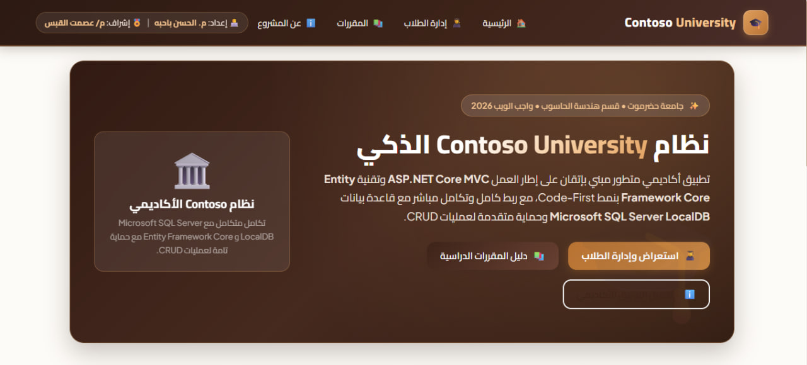
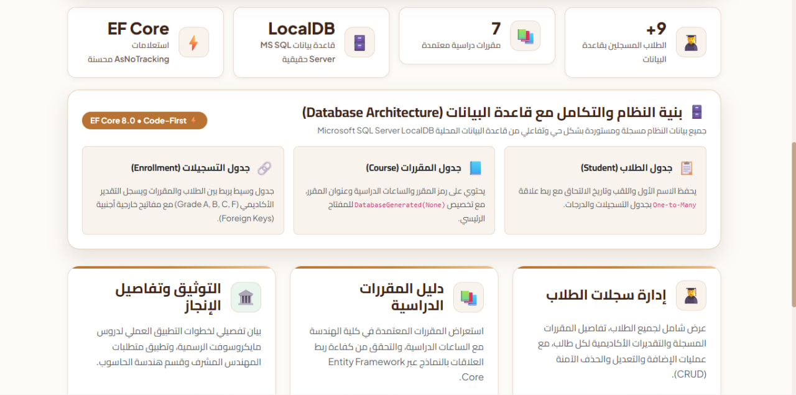
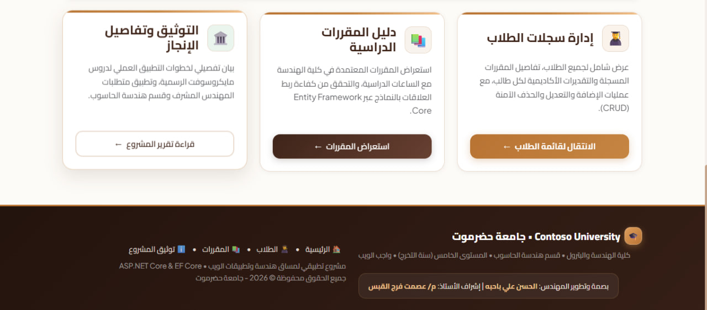
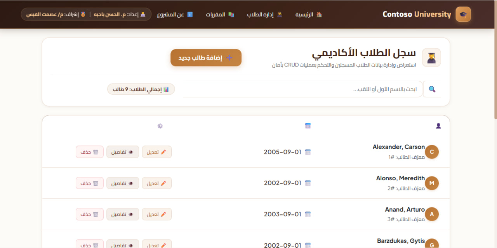
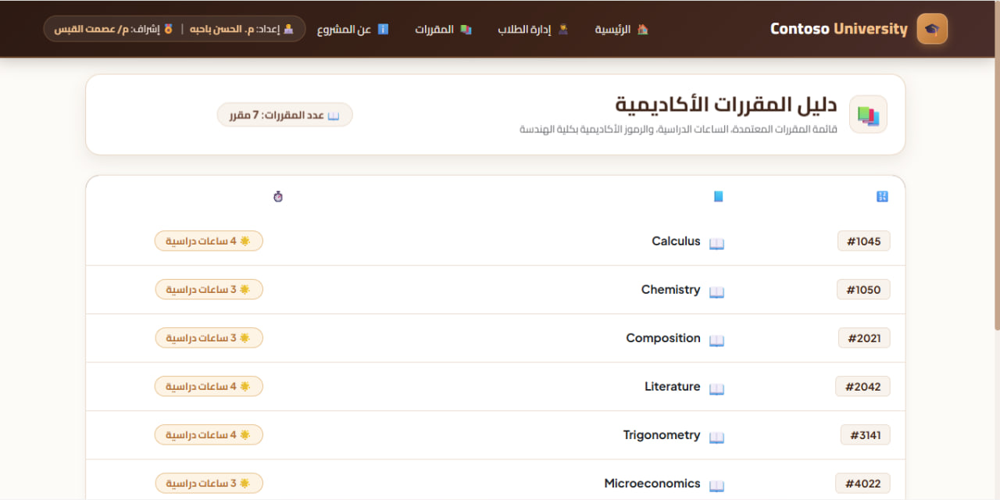
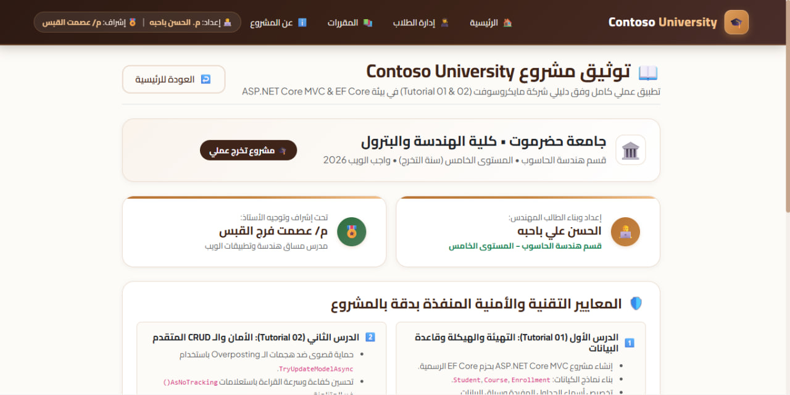

# Contoso University - ASP.NET Core MVC & Entity Framework Core
## تطبيق عملي شامل وفق دليلي Microsoft Learn (الدرس الأول والثاني - Tutorials 01 & 02)

**جامعة حضرموت | كلية الهندسة والبترول**  
**قسم هندسة الحاسوب | المستوى الخامس (سنة التخرج)**  
**تاريخ التوثيق:** نوفمبر 2026م  

---

**إعداد المهندس:**  
الحسن علي باحبه  

**إشراف:**  
م/ عصمت فرج القبس  

---

### 1. نظرة عامة على المستودع (Repository Structure)
يحتوي هذا المستودع على:
1. **مجلد المشروع (`ContosoUniversity/`):** كود المصدر الكامل لتطبيق ASP.NET Core MVC ونظام إدارة الكائنات EF Core بنمط Code-First.
2. **مجلد لقطات الشاشة (`Images/`):** صور وواجهات النظام بعد تطبيق الهوية البصرية الأكاديمية الجديدة ومنظومة الأيقونات والإيموجيات.

```text
Contoso-University/
│
├── ContosoUniversity/                  # مجلد مشروع التطبيق البرمجي
│   ├── ContosoUniversity.sln           # ملف الحل في Visual Studio
│   ├── ContosoUniversity.csproj        # ملف إعدادات وحزم المشروع
│   ├── Program.cs                      # نقطة البداية وإعداد الخدمات وقاعدة البيانات
│   ├── appsettings.json                # إعدادات سلسلة الاتصال بـ LocalDB
│   ├── Controllers/                    # متحكمات النظام (Home, Students, Courses)
│   ├── Models/                         # نماذج البيانات (Student, Course, Enrollment)
│   ├── Data/                           # سياق قاعدة البيانات (SchoolContext, DbInitializer)
│   ├── Views/                          # واجهات العرض Razor المشتركة والخاصة
│   └── wwwroot/                        # الملفات الثابتة (CSS, JS, Libraries)
│
├── Images/                             # مجلد صور ولقطات شاشات النظام
│   ├── 01_Home_Hero_Section.jpg
│   ├── 02_Home_Database_Architecture.jpg
│   ├── 03_Home_Features_And_Footer.jpg
│   ├── 04_Students_Management_List.jpg
│   ├── 05_Courses_Directory.jpg
│   └── 06_About_And_Documentation.jpg
│
├── README.md                           # دليل التوثيق الرئيسي للمستودع
└── .gitignore                          # استثناء ملفات البناء والملفات المؤقتة
```

---

### 2. معرض واجهات وتصميم النظام (System Screenshots Gallery)

#### 01. الصفحة الرئيسية - ترويسة البداية وشريط التنقل (Home - Hero Section)


#### 02. الصفحة الرئيسية - الإحصائيات وبنية قاعدة البيانات (Home - Database Architecture)


#### 03. الصفحة الرئيسية - بطاقات الخدمات وتذييل الصفحة (Home - Features & Footer)


#### 04. إدارة وسجل الطلاب الأكاديمي (Students Management List)


#### 05. دليل المقررات الأكاديمية المعتمدة (Courses Directory)


#### 06. صفحة التوثيق وتفاصيل المشروع (About & Academic Documentation)


---

### 3. ما تم تنفيذه في الدرسين 01 و 02 (Tutorials Summary)
1. **الدرس الأول (Tutorial 01):**
   - إنشاء هيكل المشروع وتكوين سياق `SchoolContext`.
   - بناء الكيانات `Student`, `Course`, `Enrollment` وتعريف العلاقات.
   - تهيئة قاعدة البيانات والتغذية التلقائية بالبيانات الأولية `DbInitializer`.
   - التكامل المباشر والحي مع **Microsoft SQL Server LocalDB** (`ContosoUniversity1`).

2. **الدرس الثاني (Tutorial 02 - التخصيص والأمان):**
   - حماية استمارة الإضافة والتعديل ضد هجمات التمرير الزائد (Overposting) باستخدام `TryUpdateModelAsync` وتحديد الحقول المسموحة.
   - تطبيق نمط `Read-and-Update` الموصى به برمجياً من مايكروسوفت.
   - استخدام `AsNoTracking()` و `Include / ThenInclude` لتسريع وتحسين كفاءة الاستعلامات.
   - معالجة استثناءات التحديث والحذف `DbUpdateException`.

3. **التحسينات المضافة (UI/UX & Features):**
   - هوية بصرية أكاديمية متناسقة بدرجات البني الكستنائي والعنبر والعاجي.
   - منظومة إيموجيات وأيقونات واضحة لجميع عمليات الـ CRUD والتقديرات الأكاديمية.
   - شريط ملاحة مرن متجاوب بسطر واحد دون تداخل.
   - بحث فوري لحظي في قائمة الطلاب.
   - واجهة ومتحكم كامل للمقررات الدراسية.

---

### 4. تعليمات التشغيل (How to Run)
1. عبر **Visual Studio**:
   - افتح الملف `ContosoUniversity/ContosoUniversity.sln`.
   - اضغط `Ctrl + F5` للتشغيل المباشر.
2. عبر **سطر الأوامر (CLI)**:
   ```powershell
   cd ContosoUniversity
   dotnet run
   ```
   ثم افتح المتصفح على: `http://localhost:5052`

---
**إعداد المهندس:** الحسن علي باحبه | **إشراف:** م/ عصمت فرج القبس  
**المستودع على GitHub:** [https://github.com/EngAlhassan404/Contoso-University](https://github.com/EngAlhassan404/Contoso-University)
